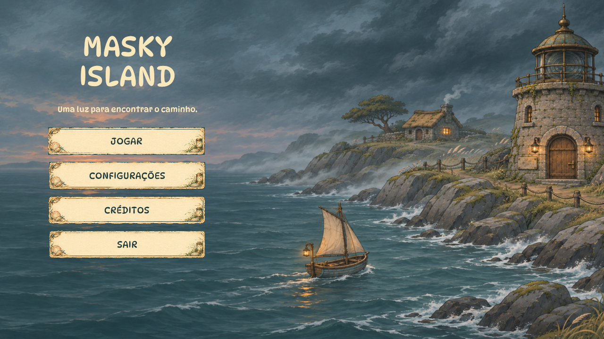
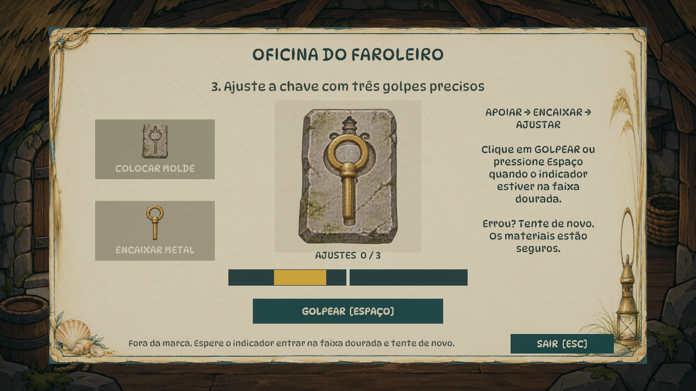
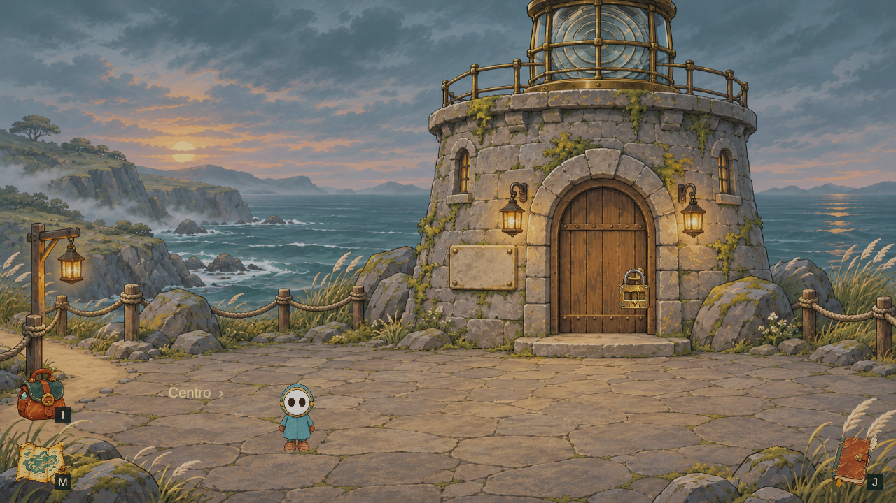
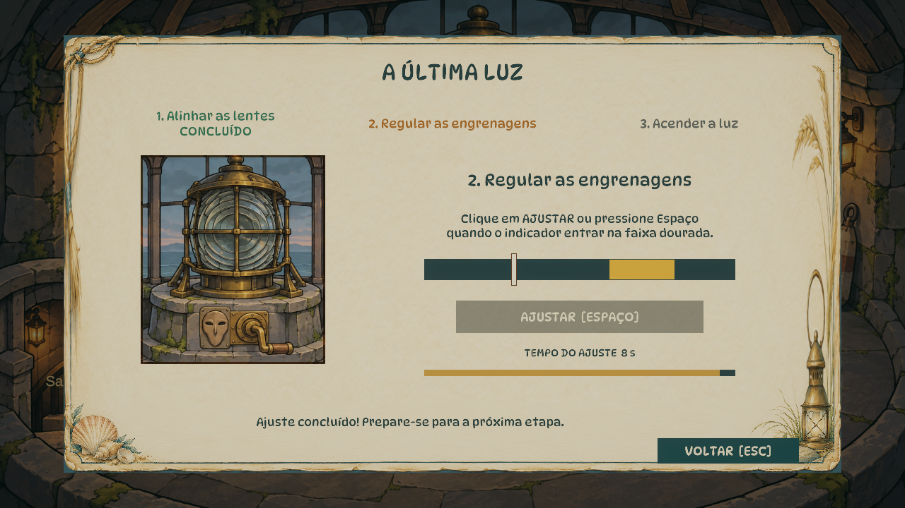

# Masky Island

Uma ilha, três lembranças e um farol apagado. Após uma tempestade, um viajante acorda na praia sem lembrar quem é. Explore cenários ilustrados, converse com um estranho e transforme pistas e materiais em um caminho de volta à sua história.

Projeto acadêmico de aventura narrativa e puzzles para um jogador, desenvolvido na UNAERP, Engenharia de Software, 8ª etapa. Interface e diálogos em português.



## Jogar

Plataforma de distribuição: Windows x64, download pelo Itch.io. O endereço público será registrado em `Documentation/Entrega/STATUS.md` após publicação e verificação. Não há versão Web publicada.

Baixe o ZIP da versão Windows, extraia **todos** os arquivos e execute `MaskyIsland.exe`. Mantenha `MaskyIsland_Data`, `UnityPlayer.dll` e as demais dependências ao lado do executável. Não é necessário instalar o Unity para jogar. O jogo não salva o progresso ao fechar; reserve uma sessão para a aventura.

## Controles

| Ação | Controle |
| --- | --- |
| Movimentar o personagem | W, A, S, D |
| Caminhar até e interagir com objetos | Clique esquerdo |
| Mochila, após coletá-la | I ou ícone da mochila |
| Mapa, após recebê-lo do NPC | M ou ícone do mapa |
| Diário, após coletá-lo na praia | J ou ícone do diário |
| Fechar painel / pausar | Esc |
| Confirmar ajuste no crafting e no farol | Espaço ou botão do painel |
| Avançar falas / pular vídeos | Botões indicados na tela |

O mapa permite viajar apenas a lugares já visitados. O diário acompanha os objetivos e risca tarefas concluídas. Não há combate, moedas nem cronômetro global.

## Mecânicas

- Explore a praia, a casa, o centro, a caverna e o farol (exterior e interior).
- Encontre o diário, conheça o NPC e obtenha mapa, mochila e picareta pelo fluxo da história.
- Decifre os símbolos da casa; minere três cristais e encaixe-os no altar da caverna.
- Recolha os materiais do esconderijo e fabrique uma chave com três ações de precisão.
- Interprete a inscrição do farol, destranque o cadeado e restaure a luz em três ajustes.
- Assista à conclusão e aos créditos. Erros nos puzzles permitem novas tentativas.





## Clonar e abrir

Requisitos de desenvolvimento: Unity Hub, **Unity 6000.6.0f1**, módulo **Windows Build Support**, Git e espaço para a importação de assets. As dependências são restauradas pelo Package Manager; consulte `Packages/manifest.json` e `Packages/packages-lock.json`.

```sh
git clone https://github.com/Joaohnt27/masky-island.git
cd masky-island
```

1. No Unity Hub, escolha **Add project from disk** e selecione a pasta clonada.
2. Abra com a versão indicada em `ProjectSettings/ProjectVersion.txt` e aguarde a importação.
3. Abra `Assets/Scenes/Splash.unity` e pressione Play para percorrer o fluxo completo.
4. Não entre em Play diretamente em cenas avançadas para avaliar a progressão: os requisitos da missão são iniciados pelo diálogo.

## Compilar para Windows

No Editor, use **Masky Island > Build Windows Release**. O arquivo é gerado em `Builds/Windows/MaskyIsland.exe`, com as dez cenas habilitadas em `EditorBuildSettings`. A primeira é Splash. A build não usa Development Build.

Também é possível executar em PowerShell, com o projeto fechado no Editor:

```powershell
& 'C:/Program Files/Unity/Hub/Editor/6000.6.0f1/Editor/Unity.exe' `
  -batchmode -projectPath (Get-Location).Path `
  -executeMethod BuildRelease.Windows -logFile build.log
```

O método encerra o processo com código 0 apenas quando a build é bem-sucedida e grava `build-report.txt`. A variável opcional `MASKY_BUILD_OUTPUT` define o caminho completo do executável. Para distribuir, compacte a pasta de saída inteira. Não versione a build no histórico de código.

## Organização e arquitetura

| Pasta | Conteúdo |
| --- | --- |
| `Assets/Scripts` | Estado, interações, movimento, puzzles e interfaces |
| `Assets/Scenes` | Cenas configuradas do jogo |
| `Assets/Art`, `Assets/Fonts`, `Assets/Resources` | Arte, fontes e recursos de execução |
| `Assets/Editor` | Ferramentas exclusivas do Editor, incluindo build |
| `Packages`, `ProjectSettings` | Dependências e configuração reproduzível |
| `Tests` | Ferramentas de autoria e validadores usados durante o desenvolvimento |
| `Documentation` | Relatórios de evolução, capturas e materiais da entrega |

`GameManager` é a fonte central do progresso e usa `DontDestroyOnLoad`. Inventário, lembranças, locais visitados, cristais encaixados e desbloqueios sobrevivem à troca de cenas, mas não ao encerramento do processo. `SettingsManager` e o nome do jogador usam preferências locais; isso não equivale a um save de campanha.

`PlayerClickMovement` combina WASD e interação por clique, usa o New Input System e bloqueios de movimento por proprietário. `Interactable` é reutilizado por objetos de interação. `DialogueController` apresenta falas e integra o começo da missão. `MiningSpot` usa coroutine; `KeyCraftingUI` e `LighthouseInteraction` implementam ações temporizadas; `SceneFade` organiza a troca de áreas e protege a entrada do farol.

Tecnologias principais: C#, Unity 6, URP 17.6.0, Input System 1.20.0, uGUI/TextMeshPro, AudioSource e VideoPlayer. Não foi introduzido framework externo de gameplay. Os pacotes instalados estão no manifesto; nem todo pacote instalado é usado pelas mecânicas.

## Verificação

Consulte `Documentation/Entrega/STATUS.md` para a verificação da entrega. Relatórios anteriores em `Documentation/*` registram testes específicos realizados em cópias isoladas; não constituem, por si só, uma certificação de toda a versão final.

O checklist de aceitação está em `Documentation/Entrega/CHECKLIST.md`. Os validadores de `Tests/GameplayValidation` usam APIs do Editor e preparação de estado. Não copie esses scripts para a pasta runtime de uma build. Ferramentas de autoria podem modificar cenas; execute-as apenas em cópia de trabalho. Algumas ferramentas históricas representam etapas antigas da história.

## Equipe e créditos

- João Henrique Nazar Tavares: programação.
- Rafael Mele Porto: arte e animação.
- Professor: Thiago Garcia Cajuela.
- Universidade de Ribeirão Preto (UNAERP), Engenharia de Software, 8ª etapa.

Fontes, recursos e procedência estão descritos em `THIRD_PARTY_NOTICES.md`. Repositório público não implica licença aberta para todos os assets. Este projeto não concede uma licença geral de redistribuição dos recursos de terceiros.
